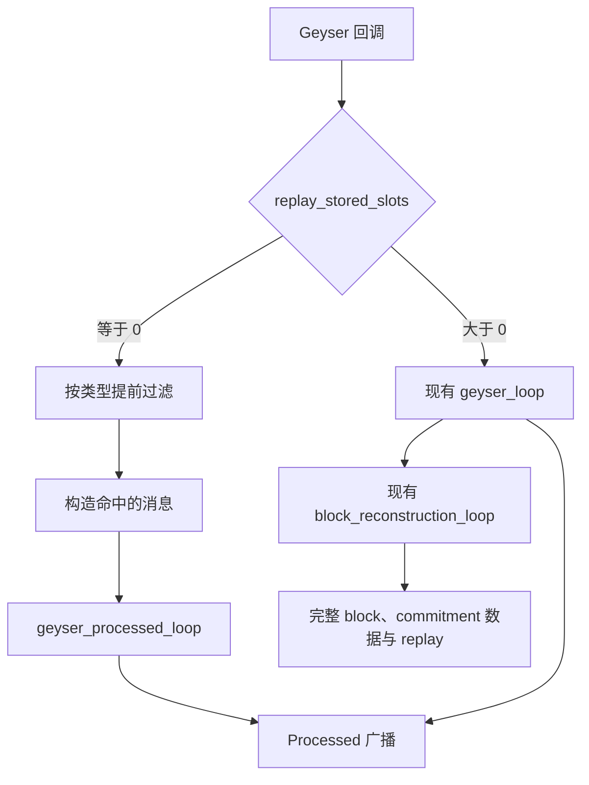

# Geyser Fast Path Optimizations

本文记录当前版本的 **Processed 自用快路径优化方案**，用于后续实现、对比和迁移。
目标是在消息构造之前过滤无关数据，并在不需要 replay 时跳过 block reconstruction，
同时保留当前版本已有的过滤器、广播和按需编码实现。

**状态：已实施。功能回归与本地性能验证记录见第 18 节；尚未完成真实验证节点流量对照。**

**方案审查结论：适合少量、稳定、窄范围的自用订阅。已收紧会增加回调工作量的部分，
仍需分别测量重建旁路和 gate 的收益；不能承诺在全量订阅等任意负载下都更快。**

## 1. 分支与范围

| 项目 | 内容 |
| --- | --- |
| 编写日期 | 2026-09-22 |
| 当前分支 | `optimize_v16.0.0-rc10+solana.4.3.0` |
| 当前基线 | `301e9cffb623aee5273ad751c9503db22d92baaa` |
| 当前插件版本 | `16.0.0-rc10+solana.4.3.0` |
| 参考分支 | `optimize_v14.0.0+solana.4.2.0` |
| 参考分支提交 | `f2a424fd2ab62067dd131568159699711a9162b8` |
| 旧优化主要提交 | `d23b00adfb357a5d255842317c678524d62be689` |
| 主要订阅 | `accounts`、`transactions`、`blocks_meta` |
| 主要 commitment | `Processed` |

采用旧优化分支的简洁设计：一个运行模式开关、独立的 Processed 循环、
回调内提前过滤，以及客户端订阅驱动的共享 gate。
本轮已实现 Rust 快路径、提前过滤和订阅清理，增加针对性测试和回调微基准；部署配置保持原样。

## 2. 使用约定

- 自用部署使用 `grpc.replay_stored_slots = 0`。
- 普通订阅使用 `Processed`，不依赖 Confirmed/Finalized 数据流。
- 不请求完整 `blocks`，不使用 `from_slot` 历史 replay。
- 沿用旧优化分支的约定，不使用交易 `token_accounts` owner 扩展。
- 提前过滤后，仍由现有客户端过滤器决定最终输出内容和 filter 名称。
- `SubscribeDeshred` 继续使用独立的数据通道和订阅条件。

这些是自用场景的使用约定，不据此新增一套订阅能力校验、自动降级或动态切换框架。
现有错误处理保持原样，例如 `replay_stored_slots = 0` 时已有的 `from_slot` 不支持响应。
必要的消息路由、订阅更新和断开清理属于实现本身，仍需正确处理。

`replay_stored_slots > 0` 时继续运行当前完整路径。运行模式在启动时确定。

## 3. 实施前基线行为

| 位置 | 实施前行为 | 本轮处理 |
| --- | --- | --- |
| Account 回调 | 检查现有 `owner_reject` 后构造消息、拷贝 account data | 实时回调移除 `owner_reject`，快路径在构造前加入订阅 gate |
| Transaction 回调 | 构造账户集合、transaction 和 meta 后入队 | 未命中时跳过这些工作 |
| `replay_stored_slots = 0` | 关闭 replay 请求通道，仍创建并运行重建任务 | 同时绕过重建 |
| `geyser_loop` | 广播 Processed 普通消息，并向重建转发 | 保留作为完整路径 |
| 广播 | Processed、Confirmed、Finalized 各自一个 channel | 保留 |
| 编码 | 每个连接发送时触发，公共内容使用共享缓存 | 保留 |
| 重建 | 使用 `block_reconstruction_v2::BlockMachineStorage` | 完整路径保留，快路径不实例化 |

`block_reconstruction.rs` 当前已不作为启用模块编译；本方案绕过的是
`block_reconstruction_v2` 的运行实例和 `block_reconstruction_loop`，不删除重建源码。

基线的 `BlockMachineStorage::gc` 即使 replay 容量为零，也受 finalized slot 最低保留量约束。
所以基线的 `replay_stored_slots = 0` 并不等于没有聚合和整块数据保留成本。

## 4. 重建旁路与双路径

继续使用 `replay_stored_slots == 0` 作为唯一开关，不新增 `processed_only`、
`reconstruction_bypass` 或单独的 early-filter 配置。



### 快路径：等于零

- 不创建重建消息通道，不启动 `block_reconstruction_loop`。
- 不实例化 `BlockMachineStorage`，不做 block 聚合、去重和 replay 存储。
- 只启动新增的 `geyser_processed_loop` 处理普通订阅消息。
- 重建 sender 在创建结果及 `PluginInner` 中改为可选值，启动时明确有无。
- 原始 slot 状态和 block meta 走普通消息队列，不再依赖重建后补发。
- 不再进行普通订阅的 Confirmed/Finalized 旁路广播。
- 小 replay 缓冲的建议日志只在完整路径生效。

### 完整路径：大于零

- 继续启动现有 `geyser_loop` 和 `block_reconstruction_loop`。
- 保留新版 bank 聚合、封块条件、commitment 推进、祖先传播和 replay。
- 不在重建输入前按当前客户端订阅丢弃 account/transaction。
- 不生成、合并或更新 gate 规则快照；不能只关闭回调检查，却仍在订阅更新时维护 gate。
- `geyser_loop` 不增加 bypass 参数，不把两种行为合并到每次循环的条件判断中。

完整路径必须保留必要的 sysvar、交易和 entry；它们参与封块，
也可能成为未来 replay 请求的数据。关闭历史 replay 与不需要实时重建是两个不同需求，
本方案只在前述自用约定下把它们合并到同一个开关。

## 5. `geyser_processed_loop` 与批量发送

新增循环复用当前的 `BatchStream` 接口，使用普通 `Vec<Message>` 接收批量消息。
职责限定为收消息、更新必要指标、广播 Processed 批次。

- 快路径批量上限固定为 `4`；完整路径 `geyser_loop` 仍为 `1024`。
- 等待第一条消息后，继续非阻塞地取当前可用消息。
- 队列暂时为空或达到上限时就广播，不等待凑满，也不新增攒批定时器。
- 一批消息交给 `Arc<Vec<Message>>` 后，为下一批重新准备 buffer，沿用现有所有权方式。
- 快路径不需要把 `BlockMeta` 分离给重建，直接按接收顺序保留在普通批次中。
- 将原本依赖重建循环更新的必要 slot 指标移到快路径对应位置；维护消息队列计数。
- 不在循环内调用 `encode_messages` 或主动预编码。
- 队列计数按实际收到的批量长度更新一次，不逐条做相同的原子扣减。

当前完整路径遇到 `BlockMeta` 会提前结束本批：先处理前面的普通消息，
再单独转发 block meta 给重建。这条顺序规则继续保留。

旧优化分支新增了默认值为 `31` 的 `processed_messages_max`，用户提供的自用配置为 `4`。
新版不移植该配置项，直接采用固定上限 `4`，不增加自适应批量或对象池。

选取 `4` 的依据是用户提供的旧优化分支两次 Prometheus 采样差值：

| 指标 | 采样区间结果 |
| --- | ---: |
| 批次数 | 288,260 |
| 消息数 | 481,120 |
| 平均批量长度 | 1.67 |
| 每批 1 条 | 95,400 批（33.1%） |
| 每批 2 条 | 192,860 批（66.9%） |
| 每批至少 3 条 | 0 批 |

其中 2 条批次由直方图 count、sum 和 `le="1"` 联合推算，统计的是循环输入，
不是客户端最终收到的消息。两个采样点的输入队列与客户端队列均为零，
`client_channel_full` 没有增长；这不排除采样之间的短暂积压，也不证明新版的最优上限。

原来的 `Vec::with_capacity(1024)` 即使只收到一两条，也会随广播批次保留整块元素容量。
当前 `Vec<Message>` 的 `Buffer` 实现以容量作为停止条件，改为 `4` 同时缩小分配容量和批量上限。
这不代表整体 RSS 或 CPU 开销按相同比例下降；新版仍需真实流量对照。

`next_batch` 内部仍是首条 `poll_recv`、后续循环 `try_recv`，与旧版
`recv().await + try_recv()` 使用相同的接收策略；接口封装本身不构成批量加速算法。
当前循环每批扣减一次队列计数，减少了旧版逐条更新该指标的工作。

`4` 是上限，不是等待目标或延迟保证。持续积压时，小批次会增加广播次数；
Processed 广播容量按批计数，默认取 `channel_capacity`，不能把它也改成 `4`。
当前不增加固定 sleep/yield；如新版出现持续积压且确认瓶颈在批次开销，再比较 `8` 或 `16`，
同时观察 CPU、RSS、尾延迟和 lag。

## 6. 新版回调、`bank_id` 和消息路由

`bank_id` 区分同一个 slot 的不同 Bank 实例。例如 slot 被重新处理后，
新旧 Bank 的交易、账户和状态不能仅凭相同 slot 就混为一组。
当前完整重建以 `bank_id` 管理缓冲；快路径保留并透传它，不新增 bank 状态机。

| 回调 / 消息 | 已实现的快路径行为 |
| --- | --- |
| `update_account_for_bank` | gate 命中后构造消息，保留 `slot`、`bank_id`、`write_version` |
| `update_account_from_snapshot` | 保留当前 snapshot 路径，不应用实时订阅 gate |
| `notify_transaction_for_bank` | gate 命中后构造消息，保留 `bank_id` |
| `update_bank_status` | 将 Processed/Confirmed/Rooted、CreatedBank 原始消息送普通队列 |
| `update_slot_status` | 保留 FirstShredReceived/Completed/Dead 原始消息的普通队列路径 |
| `notify_block_metadata_for_bank` | 普通队列直接传递 `BlockMeta`，保留 `bank_id` |
| `notify_entry_for_bank` | 继续传递原始 entry，首轮不加需求计数器 |
| `notify_block_footer` | 继续传递原始 footer，首轮不改变通知开关 |
| `notify_deshred_transaction` | 独立 gate 命中后进入 deshred 通道 |

bank/slot 状态仍按现有要求送给 deshred 通道和 unary block meta 缓存。
普通快路径只向 Processed channel 广播；其中的原始 slot 状态再由现有 slot filter 筛选。
不能因为关闭了重建 sender，就把 bank 状态发送到一个无人消费的通道。

快路径保持普通队列的接收顺序，但不等待封块，不合成缺失 commitment，
不恢复祖先 commitment，也不提供完整路径的“封块数据齐全后再发 commitment”保证。
它直接暴露原始事件，符合本方案的 Processed 自用定位。

### Block meta 的两个用途

流式订阅路径必须是：

```text
notify_block_metadata_for_bank
  → grpc_channel
  → geyser_processed_loop
  → Processed broadcast
  → FilterBlocksMeta
  → subscriber
```

现有 `blocks_meta_tx` 服务于 unary 方法缓存，继续维护；它不能替代上述流式路径。
不新增 `blocks_meta_tx_for_fast_path` 等专用旁路。
即使配置 `unary_disabled = true`，Processed 的 `blocks_meta` 订阅也应正常输出。

## 7. Account 提前过滤

在 `update_account_for_bank` 内，构造 `MessageAccount` 和拷贝 data 之前执行 gate。

1. 解析 pubkey、owner；实时回调不再执行 `owner_reject` 检查。
2. 检查所有生效 account 规则的并集；任一规则可能命中即可放行。
3. 全部不匹配时直接返回，不为新增 gate 拒绝逐条记录日志或查找指标标签。
4. 命中后复用已解析的 pubkey、owner 构造消息，保留 `bank_id`。

提前检查：`account`、`owner`、账户 cuckoo、`nonempty_txn_signature`。
其中显式 account 与 cuckoo 按现有账户过滤器的 OR 语义组合。

memcmp、datasize、lamports、token account state 留给完整过滤器。
只依赖这些条件的规则在 gate 中保守放行，避免在回调重复执行完整状态过滤。

首轮沿用旧分支合并规则后逐条匹配的方式，不新增全局 bitmap/index 框架。
当前客户端侧的 `FilterAccountsIndex` 保留。

实时回调移除 `owner_reject` 同时适用于快路径和完整路径。快路径仍按生效订阅 gate 过滤，
完整路径不做该 gate 检查；两者都不再因 owner 黑名单直接丢弃实时账户。
`update_account_from_snapshot` 仍执行 `owner_reject` 并记录 dropped 计数；
订阅创建时仍拒绝显式订阅黑名单 owner。因此，按账户地址命中的实时更新可以通过，
不代表 snapshot 或显式 owner 订阅的限制也已取消。部署配置未修改。

首轮不新增订阅 gate 的逐条 dropped 统计。
当前 `incr_geyser_event_dropped` 每次通过 `IntCounterVec::with_label_values` 查找计数器，
包含标签哈希和内部读锁；在大量未命中回调上照搬这个调用会削弱提前丢弃的收益。
如以后确需统计，可在插件初始化后缓存计数器句柄，并处理好现有指标 reset 的生命周期。

## 8. Transaction 提前过滤

在 `notify_transaction_for_bank` 内，构造 `MessageTransaction`、转换 transaction/meta
以及建立交易账户集合之前执行 gate。

借用原始数据建立 `AccountKeys`，覆盖 static keys、loaded writable、loaded readonly。
未命中的交易不建立 `HashSet`；命中后再建立一次，并传给消息构造函数复用。

规则合并同时包括 `transactions` 和 `transactions_status`，避免只有 status 订阅时误丢。
提前检查 vote、failed、signature、account_include、account_exclude、account_required，
并适配当前版本已有的 `cuckoo_account_include`。

显式 include 与 cuckoo include 必须按 OR 匹配。不能在显式 include 未命中时直接拒绝，
否则会丢掉本应由 cuckoo 放行的交易。

回调先判断标量条件，再处理账户条件，任一完整 gate 规则放行即可短路。
include/exclude 为空时略过，只有一个地址时直接在借用 keys 中比较；多个地址时，
遍历借用 keys 查询订阅更新时准备的 `FoldHashSet`。
首轮不在 gate 中复制一套 `HybridSet` 的 Vec+Set，也不增加小集合阈值配置。
当前 `HybridSet::overlaps` 的小列表分支依赖另一侧的哈希查询；换成原始切片 `contains`
后，复杂度会变化，不能直接按原有方法名或较小集合长度判断它更快。

`account_required` 保留旧分支在借用 keys 上逐个检查、失败即返回的方式，
避免仅使用 required 的窄订阅失去提前丢弃能力。可先做数量上界检查：已去重的
required 数量超过 static+loaded 原始 key 总数时，直接拒绝该规则。
原始 keys 可能重复，不能用重复命中次数证明所有 required 都已满足。

required 非空时仍可能付出 O(required × keys) 的比较成本，这不是免费优化。
首轮不因此构造每交易临时集合，也不直接删掉该条件；对 required-only 和多 required
负载单独测量，确定其提前拒绝所节省的转换成本是否覆盖比较成本。
同样不能保证单地址/多地址的固定匹配策略优于所有小集合扫描，实际地址规模必须进入对照。

沿用自用约定，首轮不在 gate 中实现 `token_accounts` owner 扩展，也不新增相关验证框架。
现有完整过滤器仍有该功能，但**快路径不能据此承诺支持它**：
只出现在 token balance owner 中的地址可能无法通过 gate。
需要这种订阅时应先补齐 gate 语义，或使用完整路径。

## 9. Deshred 提前过滤

保留独立的 deshred gate，由 `SubscribeDeshred` 规则更新。三个 gate 统一由 `FastPathFilterGates` 持有，规则集合相互隔离。
为保持单开关设计，首轮也只在 `replay_stored_slots == 0` 时启用这个 gate。

- 在 `MessageDeshredTransaction` 构造前判断 vote、include、exclude、required，使用与普通交易相同的借用匹配原则。
- 覆盖当前支持的 deshred V1/V2 输入和各自可用的 loaded addresses。
- 仅使用 deshred 订阅规则，不与普通 transaction gate 共用规则集合。
- slot 状态不经过交易 gate，继续送达 deshred 通道。
- 保留客户端完整过滤的现有实现，包括 required 判断所用的临时集合。
  不能仅以“少一次分配”为由把现有 O(keys + required) 判断改成嵌套线性扫描。

## 10. Gate 存储与订阅生命周期

复用旧分支结构：

```text
订阅更新 / 断开：StdMutex<HashMap<ClientId, Vec<Arc<Rule>>>>
                         ↓ 重建合并规则
回调读取：             ArcSwap<Vec<Arc<Rule>>>
```

- 更新路径持锁维护客户端规则，发布不可变快照。
- 每次更新只准备发生变化的客户端规则。规则中的大地址集合使用共享不可变所有权，
  实现使用 `Arc<Rule>` 共享整条规则，合并只复制句柄，不深拷贝其他客户端的地址集合。
- 回调只通过 `ArcSwap::load` 读取快照，不获取更新 mutex。
- 一次 gate 判断只读取一次快照，返回前释放 guard；不把 guard 带入消息构造、入队或后续异步工作。
- 合并时把无需前置条件即可放行的规则放在前面，减少宽订阅时的无效扫描；
  首轮不增加跨客户端规则去重、动态自适应 gate 或索引维护框架。
- 没有对应生效规则时，快路径可直接丢掉该类实时数据。
- 客户端循环实际采纳最新 filter 时才更新 gate，不对接收队列里即将被覆盖的每一版规则重建快照；
  连接结束时移除该客户端规则。
- 利用当前 `ClientSession`、`DeshredClientSession` 的生命周期挂接 guard 或等价清理，
  不另建订阅管理系统；覆盖 snapshot 订阅处理中的 filter 更新入口。
- 快路径不保留历史数据供未来新规则补收；规则生效前已经丢弃的消息不会恢复。

当前已依赖 `arc-swap` 和 `foldhash`，不为此新增 crate。

锁不在回调上不意味着更新免费：构建和发布规则仍会使用 CPU，并可能影响同一 runtime
上的发送任务。此方案针对低频更新，不据此承诺高频改订阅也无影响。
当更新与回调读取重叠时，旧快照的最后一次释放可能发生在回调线程上，
使大规则集合的释放成本进入回调尾延迟；已用独立复现确认该释放路径，尚未测量实流影响。
`ArcSwap::load` 的短期借用方式符合其[性能建议](https://docs.rs/arc-swap/latest/arc_swap/docs/performance/index.html)。

## 11. 编码策略

保留当前发送链路：

```text
Geyser 回调：转换为拥有数据的 Message
  → geyser_processed_loop：广播共享 Arc
  → client_loop：完整过滤，生成 FilteredUpdate
  → 每个连接的发送队列
  → Tonic/Prost：编码成字节并发送
```

回调里的 transaction/meta 转换与最终 protobuf 字节编码是两个阶段。
提前 gate 主要省掉未命中消息的前者、账户 data 拷贝、集合构造、排队和下游过滤。

Account/Transaction 的公共内容使用共享 `OnceLock<Vec<u8>>` 缓存；
命中缓存的连接将字节拷贝到自己的发送 buffer，外层字段仍分别编码。
账户数据切片继续走当前切片编码路径。

旧分支在广播前执行 `encode_messages`，本轮不移植。
当前 `geyser_loop` 上方仍有描述主动预编码的旧注释，实施时同步纠正。

当前 encoder 先生成字节再 `OnceLock::set`，并发首次编码可能重复计算。
`get_or_init` 可作为后续局部候选，但需比较重复工作与等待成本，首轮不改。

## 12. 与旧优化分支的取舍

| 项目 | 本方案 |
| --- | --- |
| `replay_stored_slots == 0` 开关 | 沿用 |
| 保留 `geyser_loop`，新增 `geyser_processed_loop` | 沿用 |
| Account/Transaction/Deshred gate | 沿用结构，适配当前回调和字段 |
| `ArcSwap` 读取、更新时持锁 | 沿用 |
| 过滤后再构造消息与交易账户集合 | 沿用 |
| Gate 的交易 keys 匹配 | 单地址直接比较、多地址查询订阅侧哈希集合；required 保留短路匹配并测量 |
| Deshred 客户端 required 过滤 | 保留当前算法，不为减少分配改成嵌套扫描 |
| Gate 拒绝统计 | 首轮不新增逐条标签查询和日志 |
| `bank_id` 与新回调 | 使用当前版本，直接透传 |
| `owner_reject` | 实时回调移除检查；snapshot 检查及计数、订阅创建校验保留 |
| 分 commitment 广播 | 保留当前实现 |
| 批量大小 | 快路径固定为 4，完整路径保留 1024；不增加 `processed_messages_max` |
| 广播前预编码 | 不移植，保留当前按需编码 |
| `strip_transaction_log_messages` | 首轮不移植，保留日志内容；需要时再单独增加 |
| 完整重建 | 保留当前 v2，避免回退到旧状态机 |

## 13. 实际修改文件

| 文件 | 实际改动 |
| --- | --- |
| [grpc.rs](yellowstone-grpc-geyser/src/grpc.rs) | 创建时选择路径、可选重建 sender、新 Processed 循环、gate 生命周期、纠正旧注释 |
| [entry.rs](yellowstone-grpc-geyser/src/plugin/entry.rs) | 回调提前过滤、bank/slot/meta 路由、保留旁路用途 |
| [filter.rs](yellowstone-grpc-geyser/src/plugin/filter/filter.rs) | 挂接子模块，复用现有私有过滤结构 |
| [fast_path.rs](yellowstone-grpc-geyser/src/plugin/filter/fast_path.rs) | 提前过滤规则、gate、借用 keys 匹配及过滤语义测试 |
| [filter/mod.rs](yellowstone-grpc-geyser/src/plugin/filter/mod.rs) | 导出 gate 等必要类型 |
| [message.rs](yellowstone-grpc-geyser/src/plugin/message.rs) | 构造函数复用已解析公钥与账户集合，保留新字段 |

另新增 `src/grpc_fast_path_tests.rs` 验证路由、启动模式和订阅生命周期，
`benches/fast_path.rs` 测量回调构造成本，`Cargo.toml` 仅注册该 benchmark。
未新增协议字段、配置项或依赖。
`config.rs`、`convert_to.rs`、encoder 和 v2 重建源码不作为首轮优化目标。

## 14. 实施顺序与必要验证

先实现运行路径选择和新循环，打通 slot/meta 路由，并保留一个仅旁路重建的可对照版本；
再接入各类 gate、订阅生命周期和构造参数复用，最后同步这份文档的完成状态。
这只是实现阶段的对照顺序，不新增运行时开关。

验证保持集中，不新增通用验证框架：

1. 快路径无需重建即可收到 account、transaction、block meta；unary 关闭时 meta 仍能送达。
2. 快路径按上限 4 分批，不满 4 时也能直接发出；跨批顺序和 `bank_id` 保留，关闭输入后排空。
3. Gate 覆盖未命中、ALT keys、include/cuckoo OR、transactions_status、多客户端规则并集，
   以及 required-only、数量上界、重复 keys；在约定支持的条件下，完整过滤命中应蕴含 gate 放行。
4. 更新和断开正确更新 gate；deshred 独立，slot 状态不被交易 gate 误丢。
5. `replay_stored_slots > 0` 的现有重建、路由和 replay 相关测试仍通过。

已执行本分支的功能测试；完整命令和结果见第 18 节。
仅旁路重建的中间 diff 已保存于本地临时文件，未增加运行时配置开关。

真实流量验证仍待完成：分别比较当前基线、仅旁路重建、旁路加 gate 三个版本，处理相同输入与订阅，观察 callback 耗时、
端到端延迟、CPU、RSS、平均批量长度、队列积压和 lag；同时确认输出内容符合上述约定。
覆盖无订阅、低命中、高命中、实际使用的地址列表规模、required-only/多 required 以及更新/断开；
高频改订阅作为有此需求时的额外场景，不要求为自用新建大规模压测平台。
callback 耗时单独记录：即使插件总 CPU 降低，也不能据此忽略验证节点回调变慢。
若 gate 相对于仅旁路版本在实际负载下增加明显开销，就缩减前置条件或延后该类 gate，
不拿关闭重建的收益掩盖 gate 的退化。
旧分支作为参考，不把 Agave 版本差异直接归因于某项优化。

## 15. 收益判断与后续候选

可以直接从代码路径确认的工作削减：

- 未命中消息不再构造和拷贝，也不进入普通消息队列和客户端过滤。
- 快路径不再进行 block 聚合、去重、状态推进、整块对象构造和保留。
- 交易账户集合只在 gate 命中后构建，并复用到后续消息。

提前过滤需要额外判断；订阅并集接近全量时收益变小，复杂 gate 可能增加开销。
关闭重建的收益建立在功能范围约定上。当前已有按需编码，不能把避免所有未命中消息编码
再次计算为本轮新增收益。没有流量对照之前，不承诺提速倍数或内存下降比例。

对同一种数据，设 gate 平均成本为 G，订阅并集的拒绝比例为 r，被拒绝消息原本后续
构造、排队和过滤的平均可节省成本为 C，则 gate 产生净收益需要大致满足 `G < r × C`。
这是成本判断方式，不是延迟预测公式，也不能替代实测。`r` 接近零时 gate 仍有成本，
所以提前过滤不可能仅凭设计保证所有负载都不变慢。

后续仅在实测出现对应瓶颈时考虑：

- gate 的全局 account/owner 索引；
- 无订阅的 entries/footer 跳过构造；
- encoder 首次初始化去重；
- 批量大小调优；
- 按消息类型减少无关订阅连接唤醒。

这些候选不作为第一轮实现的前置条件。

## 16. 自用场景下的 rate limit 与流量统计

当前限流不按 account/transaction 消息扣额度，也没有在 Processed 广播循环里执行。
需要区分以下机制：

| 机制 | 执行位置 | 对长连接订阅的影响 |
| --- | --- | --- |
| `MethodRatelimiter` | 每次发起 RPC 时，按 subscriber ID 和方法检查令牌桶 | `Subscribe` 建立时检查；流内更新 filter、ping 和持续推送不逐条扣 RPC 额度 |
| `ip_conncur_rate_limit` | 建立、释放连接时维护同 IP 的并发计数 | 默认 `u64::MAX`，实际不限制；读写路径直接转发 IO，不按消息或字节限速 |
| `subscription_limit` | 创建、释放订阅时维护计数 | 默认 1000，`subscription_limit_enforce` 默认 false，只记录超限 |
| `MeteredBandwidthLayer` | 响应 body 产生 data frame 时累计字节 | 持续发送路径上的统计工作，不是限速器 |
| Billing | RPC 计数及流量统计回调产生事件，后台 HTTP 上报 | 配置启用时有事件构造、入队和后台上报开销 |

默认配置需区分“没有 auth”与“有 auth 但省略 ratelimit”：

- listener 没有 `auth` 时，不构造方法限流器。
- listener 有 `auth` 而省略 `ratelimit` 时，默认创建方法限流器；默认额度为
  10 秒窗口对应的 1000 次令牌桶容量，可由订阅信息中的方法/默认额度覆盖。
- `auth.ratelimit = null` 才会关闭这个方法限流器。
- 不用 `default_max_hits = -1` 替代关闭：它只是 fallback，订阅信息可以覆盖它；
  当前 trusted-metadata 生成的订阅信息自带默认 1000 额度。`0` 也不是关闭值。
- 仓库示例 `yellowstone-grpc-geyser/config.json` 配置了 trusted-metadata 和 HTTP billing，
  不能把这份示例理解成“自用默认无鉴权、无限流、无计费”；实际部署以加载的配置为准。

如果沿用示例的 trusted-metadata 模式，自用建议将该 listener 的 `auth` 配置为：

```json
{
  "type": "trusted-metadata",
  "ratelimit": null,
  "billing": null
}
```

这只关闭方法限流和 billing，既有 auth 类型及 `x_token` 配置按部署需要保留。
trusted-metadata 仍要求请求提供 `x-subscription-id`，关闭 ratelimit 不改变鉴权行为。
IP 并发上限省略即可采用默认值；无需用 `0` 关闭，否则会拒绝已识别 IP 的新连接。

关闭方法限流不会一起关闭流量统计。`build_service` 仍挂载 `MeteredBandwidthLayer`，
每个 data frame 累计字节；当有统计 hooks 时，达到阈值后更新指标，并按配置产生 billing 事件。
当前实际默认阈值为 **32 KiB**，`config.rs` 中提到 64 KiB 的注释与实现不一致。
没有统计 hooks 时仍经过 frame 包装及字节累计，但不执行对应 hooks。

首轮按配置关闭不需要的方法限流和 billing 即可，不删除限流、鉴权或计量模块，
也不把它们与 `replay_stored_slots` 绑定。少量稳定长连接下，预计请求/连接限流本身的
性能影响有限；如后续 profiling 显示流量统计开销明显，再单独处理计量路径。
以上是源码路径判断，尚未实测 CPU 或延迟变化；本节未修改部署配置或 Rust 实现。

实现依据：
[服务层组装](yellowstone-grpc-geyser/src/grpc.rs)、
[方法限流](yellowstone-grpc-geyser/src/ratelimit.rs)、
[配置默认值](yellowstone-grpc-geyser/src/config.rs)、
[连接计数](yellowstone-grpc-tools/src/server/tonic/ratelimit/transport.rs)、
[响应流量统计](yellowstone-grpc-tools/src/server/tonic/metered.rs)。

## 17. 本次方案审查记录

以下是实施前的源码与设计审查记录，落实情况见第 18 节。

| 原方案风险 | 本文已修订为 |
| --- | --- |
| 将现有 HybridSet 直接套到原始 keys，可能由哈希查询变成嵌套扫描 | 明确单地址比较和多地址哈希查询；required 保留旧匹配，针对其比较成本单独测量 |
| 以少分配为理由改写 deshred 完整过滤，可能反而增加比较次数 | 保留现有客户端算法 |
| 每条 gate 拒绝都查找 Prometheus 标签，把统计开销放到高频拒绝路径 | 首轮直接返回，不新增逐条 gate 拒绝统计 |
| 原样合并规则会深拷贝未变化客户端的大集合；完整路径也可能付出 gate 更新成本 | 共享大集合，完整路径不维护 gate 快照 |
| 过滤后批次稀疏，但仍为每批保留 1024 容量，存在分配与内存浪费 | 后续根据旧版采样选用固定上限 4；新版 RSS 与尾延迟收益仍待实流验证 |
| 重建旁路的收益可能掩盖 gate 自身的退化 | 分三个版本对照，单独关注 callback 耗时及端到端尾延迟 |

保留的设计决定：单个配置开关、两个独立循环、固定批量上限、按需编码、
当前分 commitment 广播、原始 bank_id 透传，以及按配置关闭不需要的限流/billing。
没有加入新依赖、额外运行模式、生产验证框架或新的后台维护任务。

## 18. 实施与验证结果（2026-09-22）

### 已完成

- `replay_stored_slots == 0` 只启动 `geyser_processed_loop`，不创建重建通道或重建状态机；
  非零启动原有两个循环，且不创建 gate。
- Account、Transaction、Deshred 在消息构造前过滤。交易借用 static/ALT keys，
  接受后只构建一次账户集合；正常交易与 transaction status 规则合并。
- `FastPathFilterGates` 使用三个独立的规则快照。大集合随 `Arc<Rule>` 共享，
  客户端采纳 filter 后更新，普通和 deshred session 的 `Drop` 清理，snapshot 入口也接入更新。
- 原始 bank/slot 状态、meta、entry、footer 的路由与 `bank_id` 保留。
  只在完整路径额外广播 Confirmed/Finalized，不在快路径合成状态。
- 快路径上限改为 4，完整路径仍为 1024；保留按需编码、客户端完整过滤和 snapshot 行为；实时回调移除 `owner_reject`，
  snapshot 的检查与 dropped 计数、订阅创建时的 owner 校验保留。
  没有新建运行时校验框架，没有修改限流、billing、鉴权或部署配置。

### 功能与静态检查

```sh
cargo test -p yellowstone-grpc-geyser --lib --offline -- --test-threads=1
cargo clippy -p yellowstone-grpc-geyser --lib --tests --offline -- -D warnings
cargo fmt -p yellowstone-grpc-geyser -- --check
git diff --check
```

实时 `owner_reject` 移除后已同步对应断言，当时完整 library 测试为 169 通过。
快路径上限改为 4 后，复查为 167 通过、2 失败，均来自测试仍按 1024 编写。
本次将顺序测试改为接收 `4 + 3` 两批再比较完整消息序列，随后验证输入仍开放时单条立即发送；
关闭排空测试改用 5 条消息验证 `4 + 1`，避免测试自身的广播环被 257 批消息覆盖。
同步后重新运行完整 library 测试，**169 通过，0 失败**。快路径新增的 12 项测试覆盖：

- 两种启动模式与可选重建 sender，unary 关闭时仍收到流式 block meta；
- 跨批消息顺序、bank_id、空闲时单条发送、按 4 分批、关闭后排空、未提前编码；
- 普通订阅合并更新与取消、snapshot 注册、deshred 更新和断开；
- Account 粗过滤与客户端一致，data 条件继续交给客户端；
- 交易含 ALT、vote/failed/signature、include/exclude/required、重复 keys、Cuckoo OR、status-only 的一致性；
- 多客户端规则并集、更新/移除与共享规则；deshred V1/V2 与 shred 元数据；
- 实际回调的 bank/slot 单次路由、deshred/unary 旁路；快路径和完整路径均允许实时账户绕过
  `owner_reject`，验证收到的 pubkey、owner、bank_id 与实时标志，同时确认 snapshot 仍拒绝该账户。

本次修改后的 Clippy（将 warning 视为错误）、格式检查和 diff 检查均通过。
第一次沙箱内全量测试被本地监听端口权限限制，随后在允许本地监听的环境重跑通过。
Cargo 的版本 metadata 提示、稳定工具链忽略两项 nightly rustfmt 选项的提示是仓库既有情况。

### 回调微基准

以下保留实施阶段的微基准结果；本次同步测试和文档未重跑性能基准。

可复现入口：`yellowstone-grpc-geyser/benches/fast_path.rs`，沿用已有 Criterion 依赖：

```sh
cargo bench -p yellowstone-grpc-geyser --bench fast_path --features bench --offline
```

本机 macOS arm64、Rust 1.97.1、release/LTO；每项预热 1 秒、采样 30 次、测量 2 秒。
这是单次本地微基准，不是独占机器或验证节点实流压测。
对照项为不带 gate 的消息构造；账户两侧均使用已解析的 pubkey/owner。
交易有 32 个 static、16 个 loaded writable、16 个 loaded readonly key，其他 meta 使用默认值；
账户 data 为 4096 字节。`gate hit` 包括构造，`gate miss` 不构造消息。

| 回调样本 | 不带 gate 的构造 | gate 未命中 | gate 命中并构造 |
| --- | ---: | ---: | ---: |
| Account，单地址规则、4 KiB data | 105 ns | 19 ns | 117 ns |
| Transaction，64 keys、单 include | 4.09 μs | 0.081 μs | 4.16 μs |
| Transaction，64 keys、10000 include | 4.09 μs | 0.200 μs | 4.27 μs |
| Transaction，无前置条件 | 4.09 μs | 不适用 | 4.17 μs |
| Transaction，required-only，1 个 required | 4.09 μs | 本轮未测 | 4.07 μs |
| Transaction，required-only，8 个 required | 4.09 μs | 本轮未测 | 4.21 μs |
| Transaction，required-only，64 个 required | 4.09 μs | 本轮未测 | 5.55 μs |

以上取 Criterion 的中心估计并四舍五入，小差异不应被解读为稳定收益。
例如交易不带 gate 的区间为 3.97–4.30 μs，单 include 命中为 4.12–4.23 μs，存在重叠。
64 required 全部命中为 5.51–5.62 μs，表明大量 required 且高命中时的扫描成本不可忽略。
本轮按审查方案保留短路 required 判断，没有增加临时哈希集合、自适应策略或新开关。

低命中场景已观察到明显的构造成本削减；全命中账户样本增加约 12 ns，
大量 required 全命中的交易样本增加约 1.46 μs。不能据此承诺任意订阅组合都更快。
这些数据不包含队列、重建、客户端过滤、编码、网络及 validator 调度，
也不衡量订阅更新、deshred 回调或稀疏批次内存。
`--features bench` 编译时现有 `filter/message.rs` 的两项 test-only import 会提示 unused，基准运行成功。

### 尚未验证

当前没有真实验证节点输入，因此未完成基线／仅旁路／旁路加 gate 的端到端对照，
也未将结果与旧 Agave 4.2.0 优化分支直接作性能归因。
CPU、RSS、p99 延迟、平均批量长度、lag、deshred 与大量 required 未命中负载仍需实流验证。
当前交付为已实现并通过本地回归的源码，未修改部署配置、未部署。
